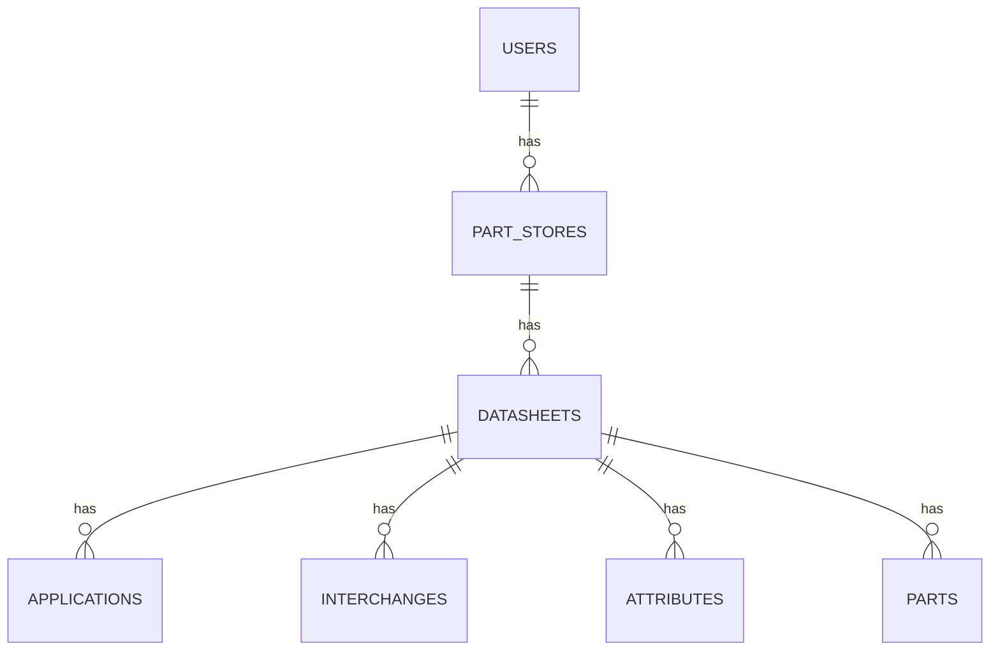

# Alcance: Catálogo Bonaparte

Documento de la prueba técnica de la Refaccionaria Trópico de Cáncer. Recoge el enunciado, el papel de cada archivo, la investigación de las cinco piezas, las decisiones de alcance y el lenguaje de dominio con el que se va a construir la aplicación.

La aplicación de Rails todavía no existe. Lo que se investiga se guarda en la base de datos, en las tablas del modelado de datos. La aplicación no carga un catálogo escrito de antemano.

## Enunciado

Hay que desarrollar una aplicación pequeña en Ruby on Rails que tome un Excel de origen y genere un Excel con la misma forma que el ejemplo.

La idea es conseguir las aplicaciones, los intercambios y los atributos reales de las piezas del archivo de origen. Se puede usar cualquier herramienta, librería, modelo o servicio para investigarlas.

La condición de la prueba es el determinismo: si el mismo archivo se procesa dos veces, el resultado tiene que ser el mismo. Un resultado distinto entre corridas se considera un error.

Entregables:

- El Excel generado con los datos catalogados.
- Acceso al repositorio con la implementación.

El encabezado comercial del catálogo es **Catálogo Bonaparte - Refaccionaria Trópico de Cáncer**.

## Los dos Excel

No son el mismo conjunto de piezas. Comparten las seis hojas y las columnas. El de ejemplo muestra el resultado ya armado de otras diez autopartes. El de datos es el ejercicio: cinco piezas, con el resto de las hojas vacías.

| Archivo | Papel | Piezas |
|---|---|---|
| `ejemplo_prueba_técnica.xlsx` | Molde del entregable. Dice cómo se escribe cada hoja cuando ya está llena. | 10 referencias distintas a las del ejercicio |
| `data_prueba_técnica.xlsx` | Entrada del ejercicio. | 5 referencias |

Ningún número de parte del archivo de datos aparece como referencia en el ejemplo. Hay parecidos que no hay que mezclar: el ejemplo trae `DM-152` y `FSX-5840299`; el ejercicio trae `RM-152` y `FSX-5840301`. `DM-152` sí aparece en el ejercicio, pero como símil escrito dentro de la descripción de `RM-152`, no como la pieza a publicar.

### Hojas y volumen del ejemplo

| Hoja | Filas en el ejemplo | Filas en los datos |
|---|---|---|
| Origen | 10 | 5 |
| Catálogo | 10 | vacía |
| Aplicaciones | 2,610 | vacía |
| Intercambios | 31 | vacía |
| Atributos | 74 | vacía |
| Métricas | el cuadro de conteos | el mismo cuadro en ceros |

Esas 2,610 filas de Aplicaciones no son 2,610 hechos distintos. Al agrupar vehículo, submodelo, motor y mercado, y dejar el año como rango, el ejemplo cabe en unos 640 registros. Cerca de 1,970 filas existen porque cada año del rango se escribe en su propio renglón.

### Columnas de cada hoja

**Origen.** Cod interno, Número de parte, Descripción del artículo, Descripcion, Grupo de articulos, Fabricante, Unidad.

**Catálogo.** Referencia, Marca, Categoría, Sistema, Subsistema, Producto, Descripción.

**Aplicaciones.** Referencia, Marca, Producto, Posición, Fabricante, Modelo, Submodelo, Año, Litros, CC, CID, Cilindros, Bloque, Combustible, Mercado.

**Intercambios.** Referencia, Marca, Producto, Intercambio, Marca intercambio, Origen.

**Atributos.** Referencia, Marca, Producto, Clase, Atributo, Unidad, Valor.

**Métricas.** Título `Catálogo Bonaparte - Refaccionaria Trópico de Cáncer`. Después, Referencias. Luego tres bloques —Aplicaciones, Intercambios y Atributos— cada uno con Origen e Incrementos. En el ejemplo, Origen está en 0 porque el archivo de entrada trae esas hojas vacías, e Incrementos es igual al total generado.

En Intercambios, la columna Origen no es la hoja de entrada. Ahí Origen vale `Aftermarket` u `OEM`.

## Cómo se pasa del Excel crudo al catálogo

Cada fila de Origen es una pieza de la refaccionaria. Trae el número propio, la marca, el grupo y una frase libre. La frase se lee de izquierda a derecha y suele traer, en este orden: números de otras marcas, el vehículo semilla, el motor, los años y alguna medida.

Esa frase no alcanza para llenar el catálogo. Dice qué buscar. Las listas reales —en qué vehículos entra, con qué otros números se pide y qué medidas tiene— salen de la ficha de autopartes de un símil.

`RM-152` ilustra el recorrido:

| Campo de origen | Valor |
|---|---|
| Cod interno | 14481 |
| Número de parte | RM-152 |
| Fabricante | REXITE |
| Grupo | BOMBA DE ACEITE |
| Descripcion | DM-152 NISSAN PICKUP L4 L6 1.8 2.4 2.0 KA24DE L20B DOHC SOHC 8V 12V 76/14 |

De ahí quedan firmes tres datos de la refaccionaria: la pieza es `RM-152`, la marca es Rexite y es una bomba de aceite. `DM-152` va al principio de la frase, antes de Nissan, y es el símil con el que se busca la ficha. La ficha encontrada es la bomba Melling `M152`, equivalente a Dynagear `DM-152`. Esa ficha aporta los vehículos, los otros números y las medidas que se publican bajo la referencia `RM-152`.

El código interno, la unidad y el texto libre se conservan en la hoja Origen. No se reinterpretan para inventar filas.

### Dónde se busca

No hay una base de autopartes con una conexión clara para estas marcas. La investigación se hace en fichas públicas: se busca el símil entre comillas, junto con el alias en inglés del grupo. Una página sirve cuando el candidato es el número de esa ficha. Si ninguna lo es, sirve una ficha de un solo producto del mismo grupo en la que el candidato aparece como intercambio. Ahí se leen aplicaciones, intercambios y especificaciones. Se guarda esa página, no una mezcla de fuentes.

Un número que no aparece, o que aparece en otra pieza distinta, no se publica.

## Las cinco piezas investigadas

Estas cinco piezas se leyeron en fichas públicas para saber qué se puede publicar. Cada dato sale de una de esas páginas. Un código de la frase que ninguna ficha confirmó no se publica como intercambio. Cuando la aplicación las investigue, ese resultado queda en `datasheets`, `parts`, `applications`, `interchanges` y `attributes`. La aplicación guarda las listas de una sola página, la primera que cumpla. Los conteos de esta sección juntan lo que se leyó a mano en varias fuentes y pueden ser mayores que los de esa página.

| Referencia | Marca | Producto | Aplicaciones | Intercambios | Atributos |
|---|---|---|---|---|---|
| RM-152 | Rexite | Bomba de aceite del motor | 8 rangos | 22 | 12 |
| TK1283-1 | Revo | Kit de cadena de tiempo | 19 rangos | 4 | 14 |
| HL-7025S | Elgin | Puntería hidráulica | 2 rangos | 6 | 3 |
| SP26-329R/L+20 | Safety | Pistón de motor | 2 rangos | 0 | 2 |
| FSX-5840301 | Fraco | Juego de empaques de motor | 6 rangos | 1 | 5 |

**RM-152.** Bomba de aceite. El símil de la frase es `DM-152`. La ficha usada es Melling `M152`. Cubre Nissan 280ZX, D21, Pathfinder, Van, 240SX, Pickup, Frontier y Xterra, con años y, cuando la ficha los da, litros y cilindros. Entre los intercambios están Dynagear, Federated, Melling, Elgin y números OEM de Nissan (`15010-F450A`, `15010-40F0A`, `15010-3S500`, `15010-40F00`). Fuentes: Parts Hawk, JEGS y YoyoPart.

**TK1283-1.** Kit de cadena de tiempo del Pentastar. El símil confirmado es Cloyes `9-0511S`. También se publican Dynagear `DDM-77020`, NAPA `90511S` y GEAR `76260`. Las aplicaciones son Chrysler, Dodge, Jeep y Ram, sobre todo 3.6 L y, en Cherokee, 3.2 L. Algunas aplicaciones de Parts Hawk no publican el litraje y se guardan sin él. Fuentes: Cloyes, Parts Hawk, el PDF de Baleros BISA y Fenix.

**HL-7025S.** Puntería hidráulica AFM/DFM de Elgin, vendida por pieza. Elgin no publica una lista de camionetas: publica familias de motor. Por eso las dos aplicaciones son `Motores LS con AFM` desde 2007 y `Motores LT EcoTec3 con DFM` desde 2019, sin año final. El ejemplo de la prueba no trae punterías; el subsistema se alineó con el tren de válvulas. Fuentes: Elgin y Northern Auto Parts.

**SP26-329R/L+20.** Pistón Safety, mano derecha e izquierda, para Chevrolet Silverado y GMC Sierra 4.3 L OHV de 12 válvulas, 2014–2022. El sufijo `+20` se lee como sobremedida de 0.50 mm (+0.020 in); Safety no publica esa medida en la línea del catálogo y queda anotada como tal. No hubo intercambios confirmados. Fuente: catálogo web de Safety Auto Parts.

**FSX-5840301.** Juego de empaques Fraco. Fraco publica la ficha como `FS5840301`; el Excel escribe `FSX-5840301`. Entra en Nissan 240SX, Silvia, Pathfinder, Pick Up D21, Terrano II y Vanette con motor KA24E 2.4 L. El intercambio confirmado es TF Victor `JC-20`. Atributos de la ficha: diámetro 89 mm, cilindrada 2389 cc, calibre de empaque de culata 1.3 mm, 12 válvulas, distribución SOHC. Fuentes: ficha PDF de Fraco y Dacomsa.

### Números que no se publican

| Pieza | Token en el Excel | Motivo |
|---|---|---|
| TK1283-1 | SA-76260 | Fenix publica `76260` de GEAR, no el texto `SA-76260` |
| SP26-329R/L+20 | 83-301 | No se confirmó como número de esta pieza |
| FSX-5840301 | QJC20G | No se confirmó en una ficha de esta pieza |
| FSX-5840301 | FS-001225 | No se confirmó en una ficha de esta pieza |

## Alcance de la aplicación

La aplicación investiga cada fila cuyo símil todavía no está en esa refaccionaria, guarda el resultado y, al publicar, solo lee lo guardado.

La primera vez que aparece un símil:

1. Lee la hoja Origen del Excel.
2. Corta la frase, sin red. Una lista fija de marcas de vehículo marca el corte: Nissan, Chevrolet, GMC, Dodge, Jeep, Ram, Chrysler, Ford y GM. La comparación no distingue mayúsculas. El fabricante de la refacción (Rexite, Elgin, Safety, Fraco, Revo) no corta la frase. Lo que está antes de la primera marca son los candidatos a símil, de izquierda a derecha. El número de parte de la columna entra al final, por si ninguno de esos candidatos tiene página. Si la frase no trae ninguna marca de la lista, el primer candidato es el número de parte y después van los tokens de la frase que traen un dígito. Lo que está después de la marca —vehículo, motor, años, medida— es pista de búsqueda. No se publica como aplicación. Un sufijo de sobremedida (`+20`, `+0.50`) no es candidato: se busca el número sin esa cola. La sobremedida se guarda como atributo solo si la ficha no la trae.
3. Busca el primer candidato en Serper, entre comillas, más el alias en inglés del grupo, más los años de la frase cuando los trae. Descarga las páginas en el orden que devuelve la búsqueda. Una página sirve cuando ese candidato, ya normalizado, es el número de la ficha. Si ninguna URL cumple eso, sirve una ficha de un solo producto del mismo grupo en la que el candidato aparece como intercambio. Si ninguna URL sirve, prueba el siguiente candidato. Las listas que se guardan son las de la página que sirvió. No se mezclan fuentes.
4. Lee las tablas de la página que sirvió. Si no devuelven listas, una llamada a `gpt-6.1-sol` en effort medium reescribe ese texto.
5. Guarda la ficha y la pieza. Si ningún candidato dejó página, la ficha queda en `not_found`, con las listas vacías y `url` en `""`. Si Serper, la descarga o el modelo no responden, ese símil se intenta hasta tres veces en la misma corrida. Si las tres fallan, la ficha queda en `failed`, vacía, con `url` en `""`. Una búsqueda que sí respondió y no trajo ficha no se reintenta: eso es `not_found`.

Dos números se comparan en mayúsculas y sin espacios, guiones, diagonales ni puntos. `9-0511S` y `90511S` son el mismo número. `SA-76260` y `76260` no lo son. `DM-152` y `M152` tampoco: son equivalentes, no dos escrituras. Si los dígitos son iguales, hay al menos cinco y la única diferencia es una letra de más en el prefijo, cuentan como el mismo número al aceptar la página. Así `FSX-5840301` acepta la ficha `FS5840301`. `152` no entra en esa segunda comparación. El `equivalent` que se guarda es el candidato tal como venía en la frase.

El alias del grupo sale de una tabla fija. No se traduce de nuevo en cada corrida. La búsqueda de la clave ignora mayúsculas y acentos, y usa la clave más larga que el grupo contenga.

| Grupo | Alias |
|---|---|
| bomba de aceite | oil pump |
| cadena de tiempo | timing chain kit |
| punteria hidraulica | hydraulic lifter |
| piston | piston |
| empaque | gasket set |

En `RM-152` la frase es `DM-152 NISSAN PICKUP L4 L6 1.8 2.4 2.0 KA24DE L20B DOHC SOHC 8V 12V 76/14` y el grupo es `BOMBA DE ACEITE`. El corte cae en Nissan, así que el candidato de la frase es `DM-152` y el número de parte `RM-152` queda al final. La consulta es `"DM-152" oil pump 1976 2014`. Esos años ayudan a elegir la página. Una ficha que trae el número y no repite los años no se descarta. Pickup, los litros, los códigos de motor y `76/14` no se escriben como filas. `76/14` queda dentro de la frase de la pieza. Los años que se guardan en `applications` son los de la ficha. Si ninguna página tiene `DM-152` como número de ficha, sirve la ficha de la bomba en la que `DM-152` es intercambio: Melling `M152`. El símil guardado sigue siendo `DM-152`.

Publicar no entra a internet. Lee el Excel de nuevo para la hoja Origen, lee las tablas para el resto y escribe el archivo. La segunda corrida del mismo archivo, en la misma refaccionaria, encuentra el símil guardado y no vuelve a buscar, tampoco cuando el estado quedó en `not_found` o `failed`. Por eso las dos salen igual. Los tres intentos de una falla viven en esa investigación. Si el proceso muere a la mitad, al reiniciar se saltan los símiles ya guardados. Esos tres intentos no se multiplican con los reintentos del job.

Si la ficha está en `not_found` o en `failed`, la fila se copia en Origen y no genera filas de catálogo, aplicaciones, intercambios ni atributos. La aplicación no copia la ficha de una pieza parecida.

## Qué se guarda y qué se calcula

El Excel resultante y las secciones de la aplicación son la misma vista: las fichas de la refaccionaria ya armadas. Cada ficha (`datasheets`) se une con sus `parts`, `applications`, `interchanges` y `attributes`. El catálogo guarda el hecho una sola vez. La pantalla y el archivo muestran esa unión.

Se guarda, en la ficha, una vez por símil dentro de la refaccionaria:

- Cada vehículo compatible, con el año como rango (`año inicial`, `año final`), no como un renglón por año.
- Cada número equivalente, con su marca y su procedencia.
- Cada medida, con clase, nombre, unidad y valor.

Se guarda, en la pieza, una vez por referencia y frase:

- Marca, categoría, sistema, subsistema, producto y descripción. Se escriben una vez, al guardar la pieza. La segunda corrida reutiliza ese texto y no lo vuelve a redactar. En este catálogo la categoría es Vehículo ligero y el sistema es Motor.
- Los códigos de la frase que la página no confirmó.
- La frase completa. Los años leídos ahí entran en la consulta y no crean filas de aplicaciones.

Al armar esa vista, para la pantalla y para el Excel, se calcula:

- Una fila por cada año de una vigencia cerrada. Nissan D21 1986–1994 produce nueve filas, del 1986 al 1994, con el resto de las columnas repetidas.
- Marca y producto repetidos en Aplicaciones, Intercambios y Atributos. Viven una sola vez en la pieza y se copian al publicar.
- CC y CID se copian en cada año. Viajan con la aplicación porque son el desplazamiento real del motor. En el ejemplo, 2.5 L corresponde a 2,488 cc y 152 CID; no se obtienen multiplicando los litros por mil.
- La hoja Origen, que es el archivo subido, escrito de vuelta igual. Código interno, texto libre, grupo y unidad pertenecen a esa línea.
- Métricas, que cuenta el archivo ya armado. No hay una tabla de métricas.

El orden de las filas sigue el orden del catálogo y, dentro de cada vigencia, el año va de menor a mayor.

Cuando la ficha no trae submodelo, mercado, cc, cid, bloque, combustible o posición, la celda queda vacía. No se inventan. Posición, en este catálogo, va vacía. El submodelo sí se guarda cuando existe, porque un mismo modelo puede cambiar de versiones según el año: el NP300 del ejemplo no trae las mismas versiones en 2016 que en 2017.

`HL-7025S` no tiene año final. Elgin publicó “desde 2007” y “desde 2019” para una familia de motor. Esa vigencia abierta se publica como una sola fila, con el año inicial y el modelo tal como está guardado (`Motores LS con AFM`, `Motores LT EcoTec3 con DFM`). No se inventan camionetas ni años posteriores. El texto “desde 2007” y “desde 2019” queda en la descripción de la pieza.

## Lenguaje de dominio

La lógica de negocio habla de cuatro conjuntos. En el Excel publicado, la pieza es la raíz: cada fila de Aplicaciones, Intercambios y Atributos lleva su referencia, su marca y su producto. En la base de datos, esas tres listas pertenecen a la ficha del símil y varias piezas pueden compartirlas. Al publicar se vuelven a unir.

### Pieza

Fila comercial de la refaccionaria.

| Concepto | Significado | Dónde se publica |
|---|---|---|
| Referencia | Número de parte de la refaccionaria | Referencia, en todas las hojas |
| Marca | Quién fabrica la refacción: Rexite, Fraco, Elgin | Marca |
| Categoría | Línea comercial. Aquí, Vehículo ligero | Categoría |
| Sistema | Sistema del vehículo. Aquí, Motor | Sistema |
| Subsistema | Familia dentro del sistema | Subsistema |
| Producto | Nombre publicable de la pieza | Producto |
| Descripción | Párrafo comercial en español | Descripción |

### Aplicación

Un vehículo en el que la pieza entra, durante una vigencia.

| Concepto | Significado | Dónde se publica |
|---|---|---|
| Fabricante | Marca del vehículo: Nissan, Chevrolet, Jeep | Fabricante |
| Modelo | Silverado, Pathfinder, Wrangler | Modelo |
| Submodelo | Versión. Puede ir vacío | Submodelo |
| Vigencia | Año inicial y año final, inclusive | Año, una fila por año |
| Litros | Desplazamiento comercial | Litros |
| CC | Centímetros cúbicos del motor | CC |
| CID | Pulgadas cúbicas del motor | CID |
| Cilindros | Número de cilindros | Cilindros |
| Bloque | Disposición: L, V | Bloque |
| Combustible | Gasolina, diésel | Combustible |
| Mercado | MEX o USA | Mercado |
| Posición | Lugar de la pieza en el vehículo | Posición |

Una aplicación se distingue por fabricante, modelo, submodelo, mercado, motor y vigencia. El mismo modelo con otra versión, u otro mercado, es otra aplicación.

**Marca** es la marca de la refacción. **Fabricante** es la marca del vehículo. No se intercambian.

### Intercambio

Otro número con el que se pide la misma pieza.

| Concepto | Significado | Dónde se publica |
|---|---|---|
| Número | El otro número de parte | Intercambio |
| Marca | Marca de ese número | Marca intercambio |
| Procedencia | Aftermarket u OEM | Columna Origen de Intercambios |

Se distingue por número y marca. `DM-152` de Dynagear y `DM-152` de Federated son dos intercambios. Una pieza puede no tener ninguno. En el dominio se dice procedencia para no confundirla con la hoja Origen. Si la marca del intercambio está en la lista de marcas de vehículo, la procedencia es OEM. Si no está, es Aftermarket.

### Atributo

Una medida o característica de la pieza.

| Concepto | Significado | Dónde se publica |
|---|---|---|
| Clase | Familia de la medida: Altura, Material, Tipo | Clase |
| Nombre | La medida concreta | Atributo |
| Unidad | mm, L, in. Puede ir vacía | Unidad |
| Valor | 154, Acero, Sí | Valor |

Se distingue por clase y nombre. La misma clase puede repetirse con nombres distintos.

### Publicar un catálogo

Es la operación que arma las fichas con sus tablas relacionadas. Recibe las líneas del archivo de entrada y, por cada fila de Origen, busca la pieza por su huella: referencia y frase. De ahí salen el Excel resultante y las secciones de la aplicación.

1. La línea de entrada se escribe tal cual en Origen.
2. Si la ficha está en `created`, la pieza publica una fila en Catálogo. Si está en `not_found` o en `failed`, no publica esa fila ni las de Aplicaciones, Intercambios y Atributos.
3. Cada aplicación se despliega por año.
4. Cada intercambio publica una fila.
5. Cada atributo publica una fila.
6. Al terminar se cuentan las filas. Eso es Métricas.

Publicar dos veces el mismo archivo produce las mismas filas en el mismo orden.

Fuentes, notas de investigación y tokens no confirmados no forman parte de los cuatro conjuntos. Un número no confirmado no es un intercambio.

## Modelado de datos

En la base de datos, las tres listas no se copian en cada pieza. Cuelgan de una **ficha** (`datasheets`), guardada una vez por símil dentro de la refaccionaria. La **pieza** (`parts`) es la fila de la refaccionaria y apunta a esa ficha con `datasheet_id`. Varias piezas de la misma refaccionaria pueden compartir la misma ficha: doscientas filas con `DM-152` leen las mismas aplicaciones, intercambios y atributos.

La refaccionaria es `part_stores`. Cada ficha pertenece a una, y una refaccionaria tiene muchas fichas. El usuario es `users`. Un usuario gestiona muchas refaccionarias, y cada refaccionaria pertenece a un solo usuario.

`parts` guarda la referencia de la refaccionaria. `datasheets` guarda lo que se investigó del símil. `part_stores` guarda quién vende esas piezas. `users` guarda quién gestiona cada refaccionaria. Al publicar, Catálogo sale de la pieza. Aplicaciones, Intercambios y Atributos salen de la ficha, y en cada fila se copian la marca y el producto de la pieza. Esa unión es el Excel resultante y las secciones de la aplicación. Origen se vuelve a leer del Excel subido. Métricas se cuenta al armar la vista.

### `users`

Una fila por persona que entra a la aplicación.

| Columna | Qué guarda |
|---|---|
| id | Identificador |
| email | Correo con el que se identifica, único |

### `part_stores`

Una fila por refaccionaria. Es la tienda de autopartes: quien sube el Excel y a cuyo nombre se publica el catálogo.

| Columna | Qué guarda |
|---|---|
| id | Identificador |
| user_id | Usuario que la gestiona. Una refaccionaria pertenece a un solo usuario |
| name | Nombre comercial. Ejemplo: Refaccionaria Trópico de Cáncer |

### `datasheets`

Una fila por símil dentro de la refaccionaria. El código buscado identifica la ficha de esa refaccionaria. El tipo de pieza entra en la consulta y no forma parte de la llave. Es lo caro de conseguir, así que no se repite por cada número de parte de la misma refaccionaria.

| Columna | Qué guarda |
|---|---|
| id | Identificador |
| part_store_id | Refaccionaria dueña de la ficha |
| equivalent | Código buscado. Único junto con `part_store_id`. Ejemplo: `DM-152` |
| url | Página de donde se leyeron las listas. En `not_found` y `failed` queda `""` |
| status | `created`, `not_found` o `failed` |

`created` significa que la página se encontró y la ficha quedó generada. `not_found` significa que la búsqueda respondió y no hubo página: la ficha se guarda vacía, con `url` en `""`, y no se reintenta, porque la ausencia ya es la respuesta. `failed` significa que Serper, la descarga o el modelo no respondieron. El conteo de esos intentos vive en el código de la investigación, no en una columna: se prueba hasta tres veces en la misma corrida. Si las tres fallan, la ficha se guarda vacía, con `url` en `""` y estado `failed`. La siguiente corrida encuentra esa fila y no vuelve a llamar. La siguiente fila con ese símil, en la misma refaccionaria, tampoco vuelve a buscar. Dos refaccionarias pueden investigar el mismo símil: cada una guarda su ficha.

### `parts`

Una fila por número de parte y frase del Excel. La huella es esa pareja, normalizada.

| Columna | Qué guarda |
|---|---|
| id | Identificador |
| datasheet_id | Ficha del símil. Varias piezas pueden apuntar a la misma |
| reference | Número de parte de la refaccionaria. Ejemplo: `RM-152` |
| phrase | Descripción libre del Excel |
| fingerprint | Referencia más frase, única entre las piezas de la misma refaccionaria |
| brand | Marca de la refacción. Ejemplo: Rexite |
| item_group | Grupo de artículos del Excel |
| category | Línea comercial. Ejemplo: Vehículo ligero |
| vehicle_system | Sistema del vehículo. Ejemplo: MOTOR. En el Excel la columna se llama Sistema |
| subsystem | Ejemplo: BOMBAS |
| product | Nombre publicable |
| description | Párrafo comercial en español, armado una vez |
| unconfirmed_tokens | Códigos de la frase que la página no confirmó. No se publican |

### `applications`

Una fila por vehículo, con el año en rango. Pertenece a una ficha.

| Columna | Qué guarda |
|---|---|
| id | Identificador |
| datasheet_id | Ficha a la que pertenece |
| sort_order | Lugar de la fila al publicar. Único junto con `datasheet_id` |
| manufacturer | Marca del vehículo. Ejemplo: Nissan |
| model | Ejemplo: D21 |
| submodel | Versión. Puede ir vacía |
| start_year | Primer año de la vigencia |
| end_year | Último año. Vacío si la vigencia está abierta |
| liters | Desplazamiento comercial |
| cc | Centímetros cúbicos del motor |
| cid | Pulgadas cúbicas del motor |
| cylinders | Número de cilindros |
| block | Disposición: L, V |
| fuel | Gasolina, diésel |
| market | MEX o USA |
| position | Lugar de la pieza en el vehículo. Puede ir vacía |

Al escribir Aplicaciones, el rango 1986–1994 se abre en una fila por año. Esas filas de un solo año no se guardan.

### `interchanges`

Una fila por número equivalente. Pertenece a una ficha.

| Columna | Qué guarda |
|---|---|
| id | Identificador |
| datasheet_id | Ficha a la que pertenece |
| sort_order | Lugar de la fila al publicar. Único junto con `datasheet_id` |
| number | El otro número de parte |
| brand | Marca de ese número |
| origin | `Aftermarket` u `OEM`. En el Excel la columna se llama Origen |

`DM-152` de Dynagear y `DM-152` de Federated son dos filas. Se distinguen por número y marca.

### `attributes`

Una fila por medida. Pertenece a una ficha.

| Columna | Qué guarda |
|---|---|
| id | Identificador |
| datasheet_id | Ficha a la que pertenece |
| sort_order | Lugar de la fila al publicar. Único junto con `datasheet_id` |
| attribute_class | Familia de la medida. Ejemplo: Altura, Material. En el Excel la columna se llama Clase |
| name | La medida concreta |
| unit | mm, L, in. Puede ir vacía |
| value | 154, Acero, Sí |

La misma clase puede repetirse con nombres distintos.

### Qué no tiene tabla

- El HTML de la página y la respuesta de Serper. Ya quedaron resumidos en la ficha.
- Una fila por cada año del rango.
- Marca y producto copiados en cada aplicación, intercambio o atributo. Se leen de `parts` al publicar.
- Métricas. Son el conteo del Excel ya escrito.
- Código interno, unidad y texto libre como columnas propias. Viajan en el archivo de entrada y se copian a la hoja Origen.
- Los años de la frase como vigencia de una aplicación. Entran en la consulta y quedan dentro de `parts.phrase`.

## Aproximación de Rails

La lógica vive en un solo objeto, fuera del controlador. Lo usa la página.

Una página sube el Excel de una refaccionaria, deja revisar el resultado y devuelve el archivo generado. El usuario que entra gestiona una o varias refaccionarias. Dos corridas del mismo archivo, en la misma refaccionaria, tienen el mismo contenido, hoja por hoja.

Para leer el Excel de origen se usa Roo. Para escribir el de salida, caxlsx. El intérprete local es Ruby 4.0.0. Las dos gemas cargan en esa versión.

**Roo** lee `.xlsx`. La 4.0.0, del 22 de octubre de 2026, pide Ruby 3.3 o más nuevo. Su CI incluye 3.3, 3.4, 4.0, ruby-head y jruby-10. En el issue [#649](https://github.com/roo-rb/roo/issues/649), del 25 de octubre de 2026, la suite completa pasó en Ruby 4.0.9: 177 pruebas de Minitest y 253 de RSpec. Al cargar avisa, porque Ruby 4 sacó CGI de la biblioteca estándar y Roo todavía hace `require "cgi"` para `CGI.unescapeHTML`. El aviso no impide leer el archivo. Hay un arreglo abierto que propone `cgi/escape`.

**caxlsx** escribe el Excel de seis hojas. Hay que usar la **4.4.2** o una posterior. Esa versión salió el 23 de marzo de 2026 e incluye el pull request [#500](https://github.com/caxlsx/caxlsx/pull/500), «Add full Ruby 4.0 support». Ahí probaron el proyecto en Ruby 4.0.0 y cambiaron el `require` de `cgi` a `cgi/escape`, porque la gema solo usa `CGI.escapeHTML`. Con eso evitaron el aviso que Roo todavía muestra. El CI actual, en [`.github/workflows/test.yml`](https://github.com/caxlsx/caxlsx/blob/master/.github/workflows/test.yml), corre las pruebas en Ruby 4.0 en Ubuntu, macOS y Windows. El requisito publicado sigue siendo Ruby 2.6 o más nuevo. Una versión anterior puede cargar en Ruby 4 y dejar el aviso de `CGI`.

La base de datos es Postgres, con las tablas de la sección Modelado de datos. Publicar lee esas tablas y arma las fichas con sus tablas relacionadas. Esa vista es la pantalla y el Excel resultante. No hay un archivo de catálogo que la aplicación cargue en cada corrida.

La búsqueda usa Serper. La lectura de la página la hace código. `gpt-6.1-sol` en effort medium entra solo cuando esa lectura no obtiene listas. La clave va en `OPENAI_API_KEY`. Si Serper, la descarga o el modelo no responden, el símil se intenta tres veces en esa misma investigación y, si las tres fallan, queda en `failed`. Un job que reinicia después de una caída no repite los símiles ya guardados y no vuelve a contar esos tres intentos.

### Métricas de una pieza desconocida

Además del cuadro del ejemplo, conviene mostrar cuántas referencias del Excel no tenían ficha. Así un archivo distinto no parece un catálogo terminado cuando solo se catalogó una parte. El cuadro del ejemplo se conserva: Referencias, y para aplicaciones, intercambios y atributos, Origen en 0 e Incrementos igual al total generado.

## Pantalla

El wireframe es una sola pantalla.

- Arriba: “Bonaparte App” y el botón “Upload data”.
- Después: el nombre de la refaccionaria, en el dibujo “Refaccionaria trópico de cancer”, y el botón “Download Excel”. Ese nombre es `part_stores.name`.
- Pestañas para revisar el resultado: Origen, Métricas, Aplicaciones e Intercambios. La pestaña activa del dibujo es Origen, y por eso se ve más grande. La tabla de abajo muestra esa hoja.
- Al cambiar de pestaña cambian las columnas, porque cada pestaña es una sección de la aplicación y una hoja del Excel. Catálogo, Aplicaciones, Intercambios y Atributos muestran la ficha unida con `parts`, `applications`, `interchanges` y `attributes`. Origen muestra el archivo subido. Métricas cuenta esa vista.

Ajustes acordados sobre el dibujo:

- Las columnas de Origen son código interno, número de parte, descripción del artículo, descripción, grupo de artículos, fabricante y unidad. En el dibujo falta el código interno, la descripción larga y la unidad, y sobra una primera columna llamada Origen.
- Faltan las pestañas Atributos y Catálogo.
- Métricas no es una tabla de piezas. Es el cuadro de conteos.

Con esos ajustes, la pantalla ya se puede construir: subir el Excel, revisar el resultado por hojas y descargarlo.

## Estado de este repositorio

Hecho:

- Investigación de las cinco piezas del archivo de datos, resumida en este documento.
- El modelado de la base de datos: `users`, `part_stores`, `datasheets`, `parts`, `applications`, `interchanges` y `attributes`.
- Este documento de alcance.

Pendiente:

- Crear la aplicación Rails.
- El objeto que publica el catálogo con los cuatro conjuntos.
- La lectura con Roo y la escritura con caxlsx, con las seis hojas y las columnas del ejemplo.
- La página del wireframe, con los ajustes de columnas y pestañas.
- La prueba de dos generaciones del mismo `data_prueba_técnica.xlsx` con el mismo contenido, hoja por hoja.
- Crear las tablas del modelado y guardar ahí el resultado de cada investigación.
