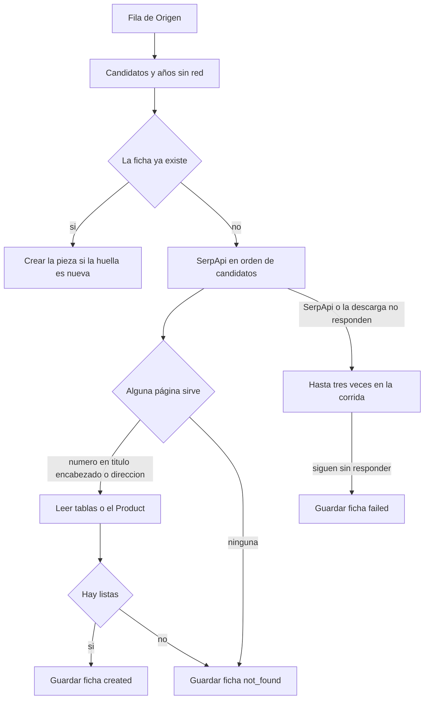

# Búsqueda de símiles

La búsqueda es la investigación de [alcance.md](alcance.md): cada fila de Origen cuyo símil aún no existe en esa refaccionaria. Publicar el Excel y la pantalla quedan fuera. La base ya tiene las tablas de la investigación. Falta `source_rows`: al leer el archivo, cada renglón de Origen se guarda ahí y el archivo no se vuelve a abrir.

La lógica vive en `CatalogResearch`, en [app/models/catalog_research.rb](../app/models/catalog_research.rb). No hereda de `ApplicationRecord` y no hay carpeta de services. Lo llama quien procese el archivo. Por dentro son métodos privados: corte, consulta, aceptación de la página, lectura y guardado. Para persistir usa `PartStore`, `SourceRow`, `Datasheet`, `Part`, `Application`, `Interchange` y `Attribute`. Roo entra al Gemfile porque el alcance lo fija para leer el `.xlsx`. SerpApi se llama con `Net::HTTP`. Consulta el motor `google` y devuelve ese orden. La clave es `SERPAPI_API_KEY`. La lectura de la página la hace el código.

## Recorrido de una fila

Se persiste al terminar la investigación de esa fila. Si el proceso muere antes, el símil no queda guardado y la siguiente corrida lo intenta de nuevo, con otros tres intentos. Esos tres no se acumulan con un reintento del job.

## 1. Leer Origen

Roo abre la hoja Origen una sola vez. Las líneas anteriores de esa ficha se reemplazan por las de este archivo. Cada fila aporta código interno, número de parte, las dos descripciones, grupo, fabricante y unidad, y se guarda en `source_rows` con su `position`. No crean filas de catálogo. La frase que se corta es `Descripcion`.

`CatalogResearch` recibe la refaccionaria y el archivo, guarda las líneas y recorre las filas en el orden del Excel.

## 2. Saltar lo ya guardado

Antes de cualquier red se calcula el símil en local. La llave de la ficha es `part_store_id` más `equivalent`, ya única en [db/schema.rb](../db/schema.rb).

- Si alguna ficha de esa refaccionaria tiene como `equivalent` un candidato de la fila, se reutiliza la primera que aparezca en el orden de candidatos. Vale también si el estado es `not_found` o `failed`.
- La pieza se busca por huella dentro de la refaccionaria: `parts` unido a `datasheets` por `part_store_id`. La huella es la referencia y la frase, en mayúsculas y con los espacios colapsados. Si ya existe, esa fila no se vuelve a escribir.
- Si la ficha existe y la huella no, se crea la pieza apuntando a esa ficha y no se redactan de nuevo categoría, sistema, producto ni descripción.

## 3. Armar los candidatos

El corte no usa red. La primera marca de vehículo parte la frase. La lista fija, sin distinguir mayúsculas, es Nissan, Chevrolet, GMC, Dodge, Jeep, Ram, Chrysler, Ford y GM. El fabricante de la refacción no corta.

- Lo que está antes de esa marca, de izquierda a derecha, son los candidatos. El número de parte de la columna va al final.
- Si la frase no trae ninguna de esas marcas, el primer candidato es el número de parte y después van los tokens de la frase que traen un dígito.
- Un sufijo de sobremedida (`+20`, `+0.50`) no es candidato. Se busca el número sin esa cola. La sobremedida se guarda como atributo solo cuando la ficha no trae esa medida.
- Lo que queda después de la marca —vehículo, motor, litros, años— entra como pista. No se publica como aplicación.

En `RM-152` la frase `DM-152 NISSAN PICKUP ... 76/14` y el grupo `BOMBA DE ACEITE` dejan el candidato `DM-152` y, al final, `RM-152`.

La consulta del candidato es el número entre comillas, la marca del vehículo, el alias en inglés del grupo y los años de la frase como un rango. Para esa fila: `"DM-152" Nissan oil pump 1976-2014`. Si esa consulta no deja una página, el mismo candidato se busca otra vez sin el rango: `"DM-152" Nissan oil pump`. Una ficha que trae el número y no repite los años se acepta igual. Los años que se guardan en `applications` son los de la ficha.

El alias sale de la tabla fija del alcance. La clave se compara sin mayúsculas ni acentos y gana la más larga que el grupo contenga: bomba de aceite, cadena de tiempo, kit de distribucion, punteria hidraulica, punteria, piston, juego de empaque, empaque. Un token `76/14` se abre en dos años de cuatro dígitos: `00`–`49` hacia `2000` y `50`–`99` hacia `1900`, y la consulta los escribe `1976-2014`. Un año que ya trae cuatro dígitos pasa igual.

## 4. Aceptar una sola página

Se prueba el primer candidato. SerpApi devuelve el orden de Google. Se descargan esas páginas en ese orden. También se abren las citas de `ai_overview`. Si el bloque solo trae `page_token`, se pide de inmediato con el motor `google_ai_overview` y se conserva el texto.

Dos números se comparan en mayúsculas y sin espacios, guiones, diagonales ni puntos. `9-0511S` y `90511S` coinciden. `SA-76260` y `76260` no. `DM-152` y `M152` no: son equivalentes, no dos escrituras. Si los dígitos son iguales, hay al menos seis y la única diferencia es una letra de más en el prefijo, cuentan como el mismo número al aceptar la página. Así `FSX-5840301` acepta `FS5840301`. `R-83-301` no acepta `83-301`. También cuenta un sufijo de solo letras sobre la misma base, con al menos cinco dígitos: `9-0511S` acepta `9-0511SX` y `9-0511SVVT`. `152` no entra en esas comparaciones.

Una página sirve cuando el candidato, ya comparado así, está en el título, el encabezado `h1` o la dirección. También sirve si el `snippet` trae el número y la página tiene una fila cuyo primer número es ese candidato y nombra una marca de vehículo, o si esa fila está en el texto de un PDF. Una mención suelta en el cuerpo no alcanza. En la bomba, Parts Hawk publica la ficha Melling `M152` y lista `DM-152` como intercambio; el título y la dirección dicen `M152`, así que esa página no entra para `DM-152`. Si la página no deja una aplicación de vehículo en su propio texto, se prueba el siguiente resultado y después el siguiente candidato. El overview de esa búsqueda no se escribe debajo de esa URL. Se lee al final de ese candidato y, si se publica, la URL queda vacía. No cierra la fila: una página de un candidato posterior la reemplaza. Si ninguna página deja una aplicación, se publica el primer párrafo que sí la dejó.

`equivalent` queda escrito como el candidato que sirvió, con sus guiones. Las listas guardadas son las de esa página. No se mezclan fuentes. El HTML y la respuesta de SerpApi no se guardan.

## 5. Leer las listas

El código lee las tablas de la página que sirvió: aplicaciones, intercambios y atributos, en el orden de la página. Ese orden se guarda en `sort_order`.

Si no hay tablas, lee el `Product` de schema.org. El hallazgo está en [alcance.md](alcance.md), en «Qué devolvió la búsqueda de FSX-5840301». La consulta `"FSX-5840301" gasket set 1989 2003` aceptó la ficha de iMotriz `FS5840301`. Esa página no trae tablas: el número del cuerpo va enmascarado y las listas están en `script[type="application/ld+json"]`. Se compararon tres fichas de esa plantilla, `FS5840301`, `FS5840300` y `OS5840301`, y el lector sigue lo que las tres comparten:

- `sku` o `mpn` es el número de la ficha. El nombre es el producto. El texto anterior a «Aplicación y Compatibilidad» es la descripción.
- La marca va antes de los dos puntos. Los modelos se parten en «y» o en coma. «desde 1993» deja año inicial y año final vacío. `2.4L` o `2.7 L` es el litraje. «años no especificados», o un motor solo entre paréntesis, no inventan un año.
- Los intercambios salen de `alternateName`, sin repetir el propio `sku`. Si la frase «Referencias equivalentes / Intercambios» trae números, también entran. La ficha de iMotriz no les pone marca, así que la procedencia queda `Aftermarket`.
- En `FS5840301` eso publica Nissan D-21 desde 1993 y los intercambios `1010140F26`, `1010140F87` y `50241400`. No publica atributos ni `JC-20`: eso está en el PDF de Fraco, que esta descarga no lee.

Los otros resultados de esa consulta no enseñaron otro patrón: fichas de otro número, una página de refa100 de `FSX-5840120` y redirecciones de Google.

La consulta `"9-0511S" Chrysler timing chain kit 2011-2013` aceptó una ficha de Cloyes `90511S` cuya descripción trae `Fits:`. Cada tramo, separado por punto y coma, empieza con años y termina con una marca de la lista y el modelo. Un año suelto deja `end_year` vacío. `2011, 2013-2014 Chrysler Town & Country` son dos aplicaciones, 2011 y 2013–2014, no un rango 2011–2014.

Si no hubo tablas, frase de iMotriz ni `Fits:`, se lee una fila de catálogo. El primer número de la fila es el candidato y la fila nombra una marca de vehículo. `FS-001225 NISSAN PICKUP 1989-2003` publica Nissan Pickup de 1989 a 2003. En un PDF se lee el texto del archivo, no el título. Una aplicación, venga de tabla, de catálogo o de la transcripción, se queda cuando trae fabricante, un modelo de vehículo y un año inicial entre 1950 y 2030. El nombre empieza con letra o número. Cada palabra es letra, número, guion, diagonal o `&`. `Or Major`, `) V8 Engines`, `Engine Code`, `Plastic Lifter` y un año como `7954` no se publican. `Silverado 1500`, `240SX` y `Town & Country` sí. Una fila sin año no se publica. Las filas repetidas se quedan en una. Si la frase trae un solo rango y el año de la fila cae fuera, esa fila tampoco. Una medida con `approximately` o `aprox`, y una clase que es un número de parte, tampoco. Si la tabla no deja una aplicación, no cierra la página: se sigue con la fila de catálogo y, si el texto nombra al candidato, con `gpt-6.1-sol`. El párrafo comercial del `Product` no se copia como descripción. El overview entra solo cuando ninguna página de ese candidato dejó una aplicación, y no hereda su URL. La transcripción se publica si el número que devuelve es el candidato. Si viene vacío, es otro número, o la descripción dice que la lista no está confirmada, que el número no corresponde, que no coincide, que la compatibilidad no está establecida o que las aplicaciones son ejemplos, no se publica. Sin una aplicación no se publican intercambios, atributos ni sobremedida.

De cada aplicación se guardan fabricante, modelo, submodelo, vigencia, litros, `engine_cc`, `engine_cid`, `engine_cylinders`, bloque, `fuel_type` y mercado. La vigencia es `start_year` y `end_year`; un rango no se abre en una fila por año. Si la ficha dice «desde 2007» y no hay año final, `end_year` queda vacío y el modelo se guarda tal cual. La posición queda vacía. CC y CID se copian como vienen en la ficha. Si la frase dice un solo litraje, un solo CID, un solo número de cilindros o un solo bloque, ese valor llena el campo que la ficha dejó vacío. `V6 262 4.3` llena 4.3 L, 262 CID, 6 cilindros y bloque V. `1.8 2.4 2.0` junto con `L4 L6` no llena litros ni cilindros. Un `12 VAL` o un `16V` único se agrega como atributo de número de válvulas.

Cada intercambio guarda número, marca y procedencia. Si la marca está en la lista de marcas de vehículo, la procedencia es `OEM`; si no, `Aftermarket`. Se distinguen por número y marca. No se guarda el número de la ficha ni el número de parte de origen, tampoco un número cuyo primer token es uno de esos, como `83-301 00` junto a `83-301`. Los otros candidatos de la frase se agregan como intercambio `Aftermarket`, sin marca inventada.

Cada atributo guarda clase, nombre, unidad y valor. La sobremedida de la frase se agrega solo cuando la ficha no la trae.

Los códigos de la frase que no quedaron como número de la ficha ni como intercambio van a `parts.unconfirmed_tokens`.

## 6. Guardar el resultado

En la misma escritura quedan la ficha, sus listas y la pieza.

- `created`: había página con listas. `url` es esa página. La pieza guarda referencia en `part_reference`, frase, huella, marca, grupo, categoría `Vehículo ligero` y sistema `MOTOR`. El subsistema y el producto salen del grupo, en mayúsculas: bomba de aceite es `BOMBAS` y `BOMBA DE ACEITE DEL MOTOR`, pistones es `COMPONENTES DEL BLOQUE DE CILINDROS` y `PISTÓN DE MOTOR`, juego de empaques es `JUNTAS Y SISTEMAS DE SELLADO` y `JUEGO DE EMPAQUES DE MOTOR`, kit de distribución y punterías son `COMPONENTES DEL TREN DE VÁLVULAS` con `KIT DE CADENA DE TIEMPO` o `PUNTERÍA HIDRÁULICA`. La descripción se lee una sola vez.
- `not_found`: SerpApi respondió y ningún candidato dejó página con listas. Las listas quedan vacías y no se reintenta. Si una página coincidió por el número, `url` guarda esa dirección y el `equivalent` es el candidato que coincidió. Si ninguna coincidió, `url` queda en `""` y el `equivalent` es el primer candidato.
- `failed`: SerpApi o la descarga no respondieron en los tres intentos de esa investigación. Listas vacías y `url` en `""`. [app/models/datasheet.rb](../app/models/datasheet.rb) ya exige `url`, así que el vacío es `""` y no `nil`.

`url` vacío cumple la validación de presencia porque es una cadena vacía, no un nulo. La pieza de una ficha vacía se guarda para recordar la huella; al publicar no genera Catálogo, Aplicaciones, Intercambios ni Atributos. Eso lo hará la publicación, no esta búsqueda.

## Pruebas

Specs del corte, el alias, los años y la comparación de números con los casos del alcance: `RM-152`, `76/14`, `FSX-5840301` contra `FS5840301`, `SA-76260` contra `76260`, y `DM-152` contra `M152`.

Specs de la lectura con las tres frases de iMotriz: D-21 desde 1993, D21 y Busetón a 2.7 L sin año, y Vanette a 2.4 L con el motor entre paréntesis. El propio `sku` no se guarda como intercambio. Specs de la aceptación: el candidato en el título, el encabezado o la dirección; el `snippet` más una fila de catálogo; una mención en el cuerpo no alcanza, y la ficha de otro número tampoco, aunque liste al candidato como intercambio. No se llama a la red en la suite.
