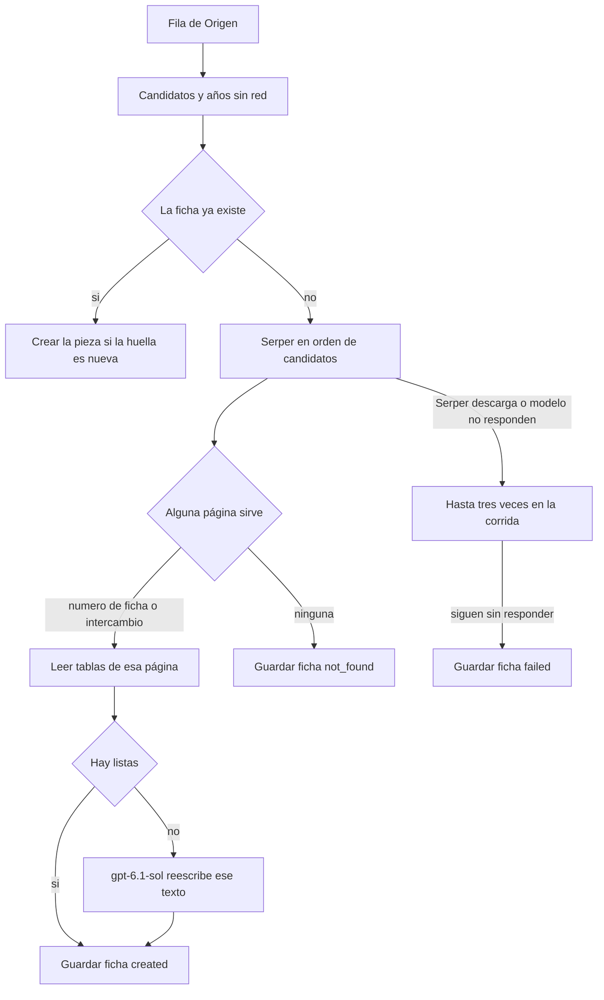

# Búsqueda de símiles

La búsqueda es la investigación de [alcance.md](alcance.md): cada fila de Origen cuyo símil aún no existe en esa refaccionaria. Publicar el Excel y la pantalla quedan fuera. La base ya tiene las tablas; no hay migración.

La lógica vive en `CatalogResearch`, en [app/models/catalog_research.rb](../app/models/catalog_research.rb). No hereda de `ApplicationRecord` y no hay carpeta de services. Lo llama quien procese el archivo. Por dentro son métodos privados: corte, consulta, aceptación de la página, lectura y guardado. Para persistir usa `PartStore`, `Datasheet`, `Part`, `Application`, `Interchange` y `Attribute`. Roo entra al Gemfile porque el alcance lo fija para leer el `.xlsx`. Serper y el modelo se llaman con `Net::HTTP`. Las claves son `SERPER_API_KEY` y `OPENAI_API_KEY`.

## Recorrido de una fila

Se persiste al terminar la investigación de esa fila. Si el proceso muere antes, el símil no queda guardado y la siguiente corrida lo intenta de nuevo, con otros tres intentos. Esos tres no se acumulan con un reintento del job.

## 1. Leer Origen

Roo abre la hoja Origen. Cada fila aporta código interno, número de parte, las dos descripciones, grupo, fabricante y unidad. El código interno, la unidad y el texto libre se conservan para la hoja Origen; no crean filas. La frase que se corta es `Descripcion`.

`CatalogResearch` recibe la refaccionaria y el archivo, y recorre las filas en el orden del Excel.

## 2. Saltar lo ya guardado

Antes de cualquier red se calcula el símil en local. La llave de la ficha es `part_store_id` más `equivalent`, ya única en [db/schema.rb](../db/schema.rb).

- Si alguna ficha de esa refaccionaria tiene como `equivalent` un candidato de la fila, se reutiliza la primera que aparezca en el orden de candidatos. Vale también si el estado es `not_found` o `failed`.
- La pieza se busca por huella dentro de la refaccionaria: `parts` unido a `datasheets` por `part_store_id`. La huella es la referencia y la frase, en mayúsculas y con los espacios colapsados. Si ya existe, esa fila no se vuelve a escribir.
- Si la ficha existe y la huella no, se crea la pieza apuntando a esa ficha y no se redactan de nuevo categoría, sistema, producto ni descripción.

## 3. Armar los candidatos

El corte no usa red. La primera marca de vehículo parte la frase. La lista fija, sin distinguir mayúsculas, es Nissan, Chevrolet, GMC, Dodge, Jeep, Ram, Chrysler, Ford y GM. El fabricante de la refacción no corta.

- Lo que está antes de esa marca, de izquierda a derecha, son los candidatos. El número de parte de la columna va al final.
- Si la frase no trae ninguna de esas marcas, el primer candidato es el número de parte y después van los tokens de la frase que traen un dígito.
- Un sufijo de sobremedida (`+20`, `+0.50`) no es candidato. Se busca el número sin esa cola. La sobremedida se guarda como atributo solo cuando la ficha no trae esa medida.
- Lo que queda después de la marca —vehículo, motor, litros, años— entra como pista. No se publica como aplicación.

En `RM-152` la frase `DM-152 NISSAN PICKUP ... 76/14` y el grupo `BOMBA DE ACEITE` dejan el candidato `DM-152` y, al final, `RM-152`.

La consulta del candidato es el número entre comillas, el alias en inglés del grupo y los años de la frase cuando existan. Para esa fila: `"DM-152" oil pump 1976 2014`. Una ficha que trae el número y no repite los años se acepta igual. Los años que se guardan en `applications` son los de la ficha.

El alias sale de la tabla fija del alcance. La clave se compara sin mayúsculas ni acentos y gana la más larga que el grupo contenga: bomba de aceite, cadena de tiempo, punteria hidraulica, piston, empaque. Un token `76/14` se abre en dos años de cuatro dígitos: `00`–`49` hacia `2000` y `50`–`99` hacia `1900`, así `76/14` queda `1976 2014`. Un año que ya trae cuatro dígitos pasa igual.

## 4. Aceptar una sola página

Se prueba el primer candidato. Serper devuelve el orden. Se descargan esas páginas en ese orden.

Dos números se comparan en mayúsculas y sin espacios, guiones, diagonales ni puntos. `9-0511S` y `90511S` coinciden. `SA-76260` y `76260` no. `DM-152` y `M152` no: son equivalentes, no dos escrituras. Si los dígitos son iguales, hay al menos cinco y la única diferencia es una letra de más en el prefijo, cuentan como el mismo número al aceptar la página. Así `FSX-5840301` acepta `FS5840301`. `152` no entra en esa segunda comparación.

Una página sirve cuando el candidato, ya comparado así, es el número de esa ficha. Si ninguna URL cumple eso, sirve una ficha de un solo producto del mismo grupo en la que el candidato aparece como intercambio. En la bomba, esa es la ficha Melling `M152`, y el símil guardado sigue siendo `DM-152`. Si ninguna URL sirve, se prueba el siguiente candidato.

`equivalent` queda escrito como el candidato que sirvió, con sus guiones. Las listas guardadas son las de esa página. No se mezclan fuentes. El HTML y la respuesta de Serper no se guardan.

## 5. Leer las listas

El código lee las tablas de la página que sirvió: aplicaciones, intercambios y atributos, en el orden de la página. Ese orden se guarda en `sort_order`.

Si esas tablas no devuelven listas, una sola llamada a `gpt-6.1-sol` con effort medium reescribe el texto de esa página. El modelo no elige otra URL ni otra ficha. La clave va en `OPENAI_API_KEY`.

De cada aplicación se guardan fabricante, modelo, submodelo, vigencia, litros, `engine_cc`, `engine_cid`, `engine_cylinders`, bloque, `fuel_type` y mercado. La vigencia es `start_year` y `end_year`; un rango no se abre en una fila por año. Si la ficha dice «desde 2007» y no hay año final, `end_year` queda vacío y el modelo se guarda tal cual. La posición queda vacía. CC y CID se copian como vienen en la ficha.

Cada intercambio guarda número, marca y procedencia. Si la marca está en la lista de marcas de vehículo, la procedencia es `OEM`; si no, `Aftermarket`. Se distinguen por número y marca.

Cada atributo guarda clase, nombre, unidad y valor. La sobremedida de la frase se agrega solo cuando la ficha no la trae.

Los códigos de la frase que esa página no confirmó van a `parts.unconfirmed_tokens`. No se crean intercambios. Así quedan fuera `SA-76260`, `83-301`, `QJC20G` y `FS-001225` cuando la ficha no los trae.

## 6. Guardar el resultado

En la misma escritura quedan la ficha, sus listas y la pieza.

- `created`: había página. `url` es esa página. La pieza guarda referencia en `part_reference`, frase, huella, marca, grupo, categoría `Vehículo ligero`, sistema `Motor`, y el subsistema, producto y descripción leídos una sola vez.
- `not_found`: Serper respondió y ningún candidato dejó página. Listas vacías, `url` en `""`, y el `equivalent` es el primer candidato. No se reintenta.
- `failed`: Serper, la descarga o el modelo no respondieron en los tres intentos de esa investigación. Listas vacías y `url` en `""`. [app/models/datasheet.rb](../app/models/datasheet.rb) ya exige `url`, así que el vacío es `""` y no `nil`.

`url` vacío cumple la validación de presencia porque es una cadena vacía, no un nulo. La pieza de una ficha vacía se guarda para recordar la huella; al publicar no genera Catálogo, Aplicaciones, Intercambios ni Atributos. Eso lo hará la publicación, no esta búsqueda.

## Pruebas

Specs del corte, el alias, los años y la comparación de números con los casos del alcance: `RM-152`, `76/14`, `FSX-5840301` contra `FS5840301`, `SA-76260` contra `76260`, y `DM-152` contra `M152`.

Specs de `CatalogResearch` con Serper, la descarga y el modelo simulados: reutilizar una ficha existente, aceptar el número de ficha antes que el intercambio, guardar `DM-152` cuando la página es `M152`, no mezclar dos páginas, `not_found` sin reintento, `failed` al tercer fallo, y la huella repetida sin otra búsqueda. No se llama a la red en la suite.
